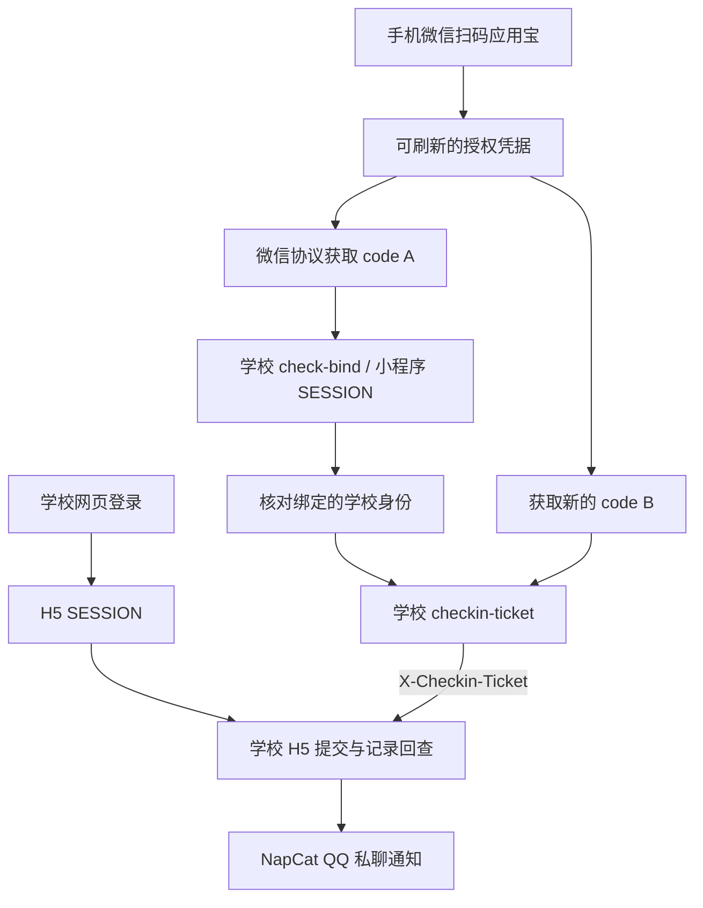

# GoodNightUESTC

面向电子科技大学「晚安成电」的独立服务：通过容器浏览器维护学校会话，使用微信协议获取小程序操作票据，按配置执行页面流程、复查当日记录，并通过 **NapCat OneBot HTTP API** 发送 QQ 私聊通知。

项目使用 Python、Playwright 与 Docker Compose。NapCat 为可选通知通道；已有 NapCat 或 AstrBot 的用户可以直接复用 QQ 连接，各服务独立运行。

## 能力与验证状态

- 学校会话恢复，验证码或二次认证时暂停自动登录。
- 首次微信扫码授权应用宝，保存加密凭据，后续免扫码申请新的小程序 code 和学校 ticket。
- 提交前核对学校身份；每次获取新票据，限制一次指定签到 POST，并查询当日记录确认结果。
- 每日定时任务、持久化防重状态，以及独立的 QQ 通知补发队列。
- 无需运行 Android 模拟器或常驻桌面微信。

**当前已验证**学校会话恢复、云端扫码取票、跨进程免扫码取票、主动刷新及刷新后取票。新协议票据下的正式签到、跨日与实际到期刷新仍待验证。离线测试与真实验证分别记录在 [验证说明](docs/validation.md)，不以模拟测试代替线上结果。

## 工作原理



code A、code B 分别用于小程序登录和换票；正式签到请求头携带学校签发的 `X-Checkin-Ticket`。应用宝 token、微信 code、两类 SESSION 与 ticket 的区别见 [微信授权链路](docs/wechat-authorization.md)。

## 快速开始

准备 Docker Engine / Docker Desktop 与 Docker Compose v2，进入仓库根目录：

```bash
umask 077
cp -n .env.example .env
chmod 600 .env
docker compose build cli debug
docker compose run --rm test
docker compose run --rm cli demo
```

测试与 demo 使用模拟服务，不请求学校业务接口或发送真实 QQ 消息。示例配置预置公开的学校页面选择器，学校页面更新后可能需要重新核对；凭据、收件人和坐标均留空，默认关闭提交。

首次使用依次完成：

1. 按 [首次配置与登录](docs/getting-started.md) 在专用容器浏览器登录学校。
2. 运行 `bash scripts/wechat-authorize.sh`，用已绑定学校账号的微信扫码确认应用宝授权。该命令只验证取票。
3. 运行 `docker compose run --rm cli wechat-ticket`，验证免扫码取票。
4. 按 [配置说明](docs/configuration.md) 核对位置与业务配置；需要 QQ 通知时再接入 NapCat。

```bash
# 恢复并检查学校会话，不提交密码或签到
docker compose run --rm cli check
# 只查询今日记录；配置 NapCat 后会发送状态通知
docker compose run --rm cli status
# 明确执行一次业务流程，要求 CHECKIN_ENABLED=true 且配置完整
docker compose run --rm cli run
```

## NapCat 接入

在已有 NapCat 中启用 **OneBot HTTP 服务端**，配置访问 Token，并在本项目 `.env` 中填写：

```dotenv
NAPCAT_HTTP_URL=http://napcat:3000
NAPCAT_TOKEN=<OneBot HTTP Token>
QQ_USER_ID=<接收通知的 QQ 号>
BOT_NETWORK=<已有的 Docker 网络名>
```

地址和端口以你的配置为准。6099 通常是 NapCat WebUI，不能作为消息 API。共用 Docker 网络时，通过覆盖配置连接已有 NapCat：

```bash
docker compose -f compose.yaml -f compose.napcat.yaml run --rm cli status
```

通知请求使用 `POST /send_private_msg` 和 `Authorization: Bearer <Token>`，同时检查 HTTP 结果、OneBot `retcode` 和 `message_id`。失败仅补发通知，不重新执行签到。完整网络示例和独立使用方式见 [NapCat 接入](docs/napcat.md)。

## 文档

| 文档 | 内容 |
| --- | --- |
| [首次使用](docs/getting-started.md) | 学校登录、微信扫码、只读检查 |
| [配置说明](docs/configuration.md) | 环境变量、位置、命令与副作用 |
| [微信授权链路](docs/wechat-authorization.md) | OAuth、双 code、SESSION 与 ticket 请求头 |
| [NapCat 接入](docs/napcat.md) | 网络、鉴权、通知和补发 |
| [部署与运维](docs/deployment.md) | 定时任务、数据卷、备份、恢复与升级 |
| [开发与测试](docs/development.md) | 两套 Python 运行时及离线测试 |
| [验证说明](docs/validation.md) | 已验证能力与尚未覆盖的场景 |

对外项目名为 **GoodNightUESTC**。Compose 项目名 `uestc-checkin` 和已有卷名保持兼容，修改目录名不会自动迁移已有数据。

## 鸣谢与思路来源

- [MioYiSama/moon-uestc](https://github.com/MioYiSama/moon-uestc)：本项目直接使用的微信协议与学校 API SDK，补齐应用宝授权、微信 MMTLS 取码和学校换票链路。依赖固定在提交 [`f8a93c3`](https://github.com/MioYiSama/moon-uestc/tree/f8a93c3bc4d62cea879b76560c49c9646387b386)。
- [LCX-luo/GoodnightUESTC](https://github.com/LCX-luo/GoodnightUESTC)：取票接入的重要参考，包括隔离授权 worker、学校身份核对、两个新 code 分别消费，以及加密保存授权凭据的流程。
- [beichenO2/GoodNight](https://github.com/beichenO2/GoodNight)：早期浏览器签到流程与自动化方案的参考。
- [525815266/YYB-Go-Enhanced](https://github.com/525815266/YYB-Go-Enhanced)：上游 SDK 标注的应用宝及微信协议参考来源。
- [NapCatQQ](https://github.com/NapNeko/NapCatQQ) 与 [Playwright](https://github.com/microsoft/playwright)：分别提供 QQ OneBot 接入和容器浏览器自动化能力。

本项目在这些思路上整合了 Docker 运行环境、页面提交与回查、持久化防重及 NapCat 通知。第三方授权信息与 MIT 参考项目的许可文本见 [第三方声明](THIRD_PARTY_NOTICES.md)。

## 许可与数据

本仓库原创代码采用 [MIT License](LICENSE)，第三方依赖按各自许可处理。固定版本的协议 SDK 未发现明确许可证文件，相关情况已单独记录在第三方声明中。

`.env`、浏览器 profile、微信凭据、密钥和数据卷均属于私有资料。微信密文与密钥保存在同一受控卷内，整个卷泄露仍可能泄露授权；不要分享使用过的运行目录或备份。位置配置不代表实时定位或人员在场证明。请仅使用本人账号，并遵守学校与平台要求。
