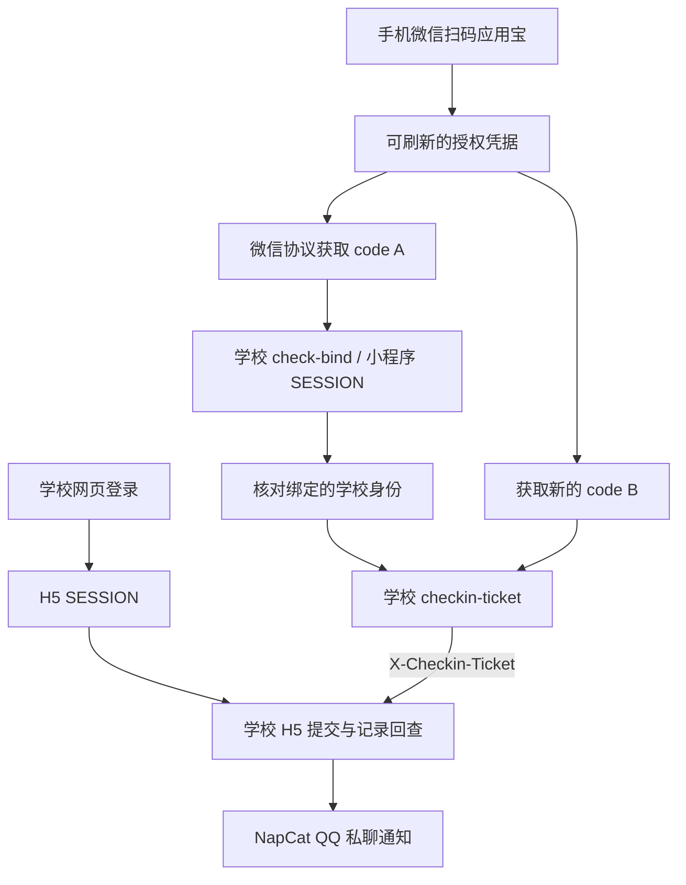

# GoodNightUESTC

面向电子科技大学「晚安成电」的独立服务：通过容器浏览器维护学校会话，使用微信协议获取小程序操作票据，按配置执行页面流程、复查当日记录，并通过 **NapCat OneBot HTTP API** 发送 QQ 私聊通知。

项目使用 Python、Playwright 与 Docker Compose，支持命令行和可选的独立 Web UI。命令行使用时 NapCat 为可选通知通道；Web UI 使用已有 NapCat WebUI 验证管理身份。已有 NapCat 或 AstrBot 的用户可以复用现有服务，各服务独立运行。

## 能力与验证状态

- 首次在容器浏览器完成学校短信验证并信任该环境；保存学校账号密码后，后续复用受信任环境登录，验证码或二次认证时暂停自动登录。
- 首次微信扫码授权应用宝，保存加密凭据，后续免扫码申请新的小程序 code 和学校 ticket。
- 提交前核对学校身份；每次获取新票据，限制一次指定签到 POST，并查询当日记录确认结果。
- 每日定时任务、持久化防重状态，以及独立的 QQ 通知补发队列。
- 独立管理页面：保存学校账号密码、打开短信验证浏览器、微信扫码授权、验证免扫码取票、查询官方记录及暂停或恢复调度。
- 无需运行 Android 模拟器或常驻桌面微信。

**当前已验证**学校会话恢复、受信任浏览器环境中的账号密码重新登录、云端扫码取票、跨进程免扫码取票、主动刷新及刷新后取票，以及新协议票据下的正式签到与记录回查。已有跨日成功记录，长期连续无人值守与协议凭据实际到期刷新仍待验证。离线测试与真实验证分别记录在 [验证说明](docs/validation.md)，不以模拟测试代替线上结果。

## 工作原理



code A、code B 分别用于小程序登录和换票；正式签到请求头携带学校签发的 `X-Checkin-Ticket`。应用宝 token、微信 code、两类 SESSION 与 ticket 的区别见 [微信授权链路](docs/wechat-authorization.md)。

## 快速开始

准备 Docker Engine / Docker Desktop 与 Docker Compose v2，进入仓库根目录：

```bash
umask 077
cp -n .env.example .env
chmod 600 .env
docker compose build cli debug
docker compose run --rm test
docker compose run --rm cli demo
```

测试与 demo 使用模拟服务，不请求学校业务接口或发送真实 QQ 消息。示例配置预置公开的学校页面选择器，学校页面更新后可能需要重新核对；凭据、收件人和坐标均留空，默认关闭提交。

首次使用依次完成：

1. 按 [首次配置与登录](docs/getting-started.md) 在实际运行的专用容器浏览器完成学校短信验证并信任环境，将学校账号密码保存到该部署的私有 `.env`，验证后续密码登录。远端部署应在服务器上完成这些操作。
2. 运行 `bash scripts/wechat-authorize.sh`，用已绑定学校账号的微信扫码确认应用宝授权。该命令只验证取票。
3. 运行 `docker compose run --rm cli wechat-ticket`，验证免扫码取票。
4. 按 [配置说明](docs/configuration.md) 核对位置与业务配置；需要 QQ 通知时再接入 NapCat。

```bash
# 恢复并检查学校会话，不提交密码或签到
docker compose run --rm cli check
# 只查询今日记录；配置 NapCat 后会发送状态通知
docker compose run --rm cli status
# 明确执行一次业务流程，要求 CHECKIN_ENABLED=true 且配置完整
docker compose run --rm cli run
```

## Web UI 管理页面

管理台提供学校登录、微信授权和日常状态管理，独立于 NapCat 运行。实际验证的 NapCat v4.18.37 会拒绝非官方白名单插件，因此当前使用独立页面入口，保留原 NapCat 版本。

### 1. 配置管理服务

先按上方快速开始创建 `.env`。在**实际运行端**的私有 `.env` 中补充以下配置，文件权限保持 0600：

```dotenv
BOT_NETWORK=<已有 NapCat 所在的 Docker 网络名>
NAPCAT_WEBUI_URL=http://napcat:6099
MANAGEMENT_TOKEN=<至少 32 字符的随机私有密钥>
```

`napcat` 替换为该网络中实际可解析的服务名或容器名；已有 NapCat WebUI 必须能从管理容器访问。这里的地址用于管理身份验证，QQ 消息仍使用下节单独配置的 OneBot HTTP API。只使用管理页时可以留空 `NAPCAT_HTTP_URL`、`NAPCAT_TOKEN` 和 `QQ_USER_ID`。

| 登录或配置项 | 用途 |
| --- | --- |
| NapCat WebUI Token | 登录管理台；开启两步验证时还需填写动态验证码 |
| `MANAGEMENT_TOKEN` | 后端私有 API 密钥，保存在服务器 `.env`，不用于网页登录 |
| `NAPCAT_TOKEN` | OneBot HTTP 消息 API Token，仅用于 QQ 通知 |
| 学校账号密码 | 在管理页保存，用于学校登录，与上述管理凭据分别维护 |

### 2. 构建并启动

在项目根目录执行，管理服务与 cli、scheduler 使用同一数据卷：

```bash
# 更新 cli 与管理镜像，确保命令行和调度器也支持网页保存的配置
docker compose -f compose.yaml -f compose.napcat.yaml -f compose.management.yaml build cli management
# 学校验证浏览器与旧 debug 服务共用 6080 端口，先关闭旧 debug
docker compose --profile debug stop debug
docker compose -f compose.yaml -f compose.napcat.yaml -f compose.management.yaml up -d --no-build management
```

已有生产部署先按 [升级流程](docs/deployment.md#升级和失败处理) 停调度并备份 `.env`、数据卷和旧镜像，再更新。已有 cloud 部署应继续加载 `compose.cloud.yaml`；可将上述命令中的 `docker compose -f compose.yaml -f compose.napcat.yaml -f compose.management.yaml` 替换为 `./scripts/cloud.sh -f compose.management.yaml`，保留原外部卷与网络。

### 3. 打开页面并登录

管理台默认仅绑定服务器 `127.0.0.1:6081`。远端部署时，在自己的电脑建立 SSH 隧道：

```bash
ssh -N -L 6081:127.0.0.1:6081 -L 6080:127.0.0.1:6080 user@server
```

打开 [Web UI 管理台](http://127.0.0.1:6081/)，填写现有 **NapCat WebUI Token** 登录；启用 NapCat 两步验证时同时填写动态验证码。本机部署可直接打开该地址。

登录会话有效期为一小时，管理服务重启后需重新登录。原始 Token 不保存在浏览器存储中。当前访问方式面向受信任的单用户服务器与 SSH 隧道，不直接开放公网。

### 4. 完成学校登录与微信授权

1. 在「学校账号」填写并保存学校账号密码；密码留空会保留原值，保存后不回显。
2. **首次学校登录需要短信验证码和环境信任。** 点击「启动学校验证浏览器」，稍候再点击「打开验证浏览器」，在服务器上的学校官方页面完成短信验证，并信任该浏览器环境。后续保留同一个 profile，才能复用环境进行账号密码登录；学校再次要求验证时仍需人工处理。
3. 点击「检查已有会话」或「验证账号登录」确认学校认证正常；学校验证浏览器会在完成、取消或超时后关闭，最长开放 10 分钟。
4. 在「微信授权」点击「扫码授权 / 恢复授权」，使用已绑定当前学校账号的本人微信扫描应用宝二维码并确认。已有有效授权时直接复用，不重新显示二维码；随后可点击「验证免扫码取票」。
5. 点击「查询今日官方记录」回查学校记录。页面顶部显示本地保存的今日结果，需要查询最新官方状态时使用此按钮。

这些登录、授权和查询操作**不提交签到、不发送 QQ 通知**。页面不提供手动签到按钮。

### 5. 启用每日调度与后续维护

先在 `.env` 中核对位置、学校页面入口与其他业务配置；如修改了这些字段，先重新创建 management 加载最新环境变量。然后在管理页开启「允许每日定时签到」，启用时会检查业务配置是否完整。首次启动或升级已有调度器时执行：

```bash
docker compose -f compose.yaml -f compose.napcat.yaml -f compose.management.yaml \
  --profile scheduled up -d --no-build --force-recreate scheduler
```

默认北京时间每日 21:05 执行。页面可随时暂停或恢复后续调度；暂停不会取消已开始的业务任务。当天已触发过的任务不会因恢复开关或重启而自动补跑。

网页保存的学校账号、密码和调度开关写入私有数据卷 `settings.json`（0600），**优先于 `.env`，后续修改即时生效**。其余部署字段仍从 `.env` 加载，修改后需重新创建相应容器。备份时同时保留 `.env` 与整个数据卷，不清空每日防重记录。

首次部署后的常见情况：

- 页面打不开：确认 management 正在运行，远端 SSH 隧道仍在连接；管理页是 6081，学校验证浏览器是 6080，NapCat WebUI 通常是 6099。
- 管理登录失败：检查使用的是 NapCat WebUI Token、动态验证码及容器内 `NAPCAT_WEBUI_URL`，不是 OneBot Token 或 `MANAGEMENT_TOKEN`。
- 学校登录暂停：先核对账号密码或打开学校验证浏览器；仅在人工核对后使用页面中的「已核对，解除暂停并登录一次」。
- 微信授权失效：页面不会自动清除原有授权；按 [失败处理](docs/deployment.md#升级和失败处理) 停止相关任务、处理微信缓存后再扫码，保留学校 profile 和每日状态。

此版本按单个学校账号维护同一 profile，不支持直接切换已有学校账号。更多认证、配置与回滚细节见 [管理页面说明](docs/management.md)。

## NapCat 接入

在已有 NapCat 中启用 **OneBot HTTP 服务端**，配置访问 Token，并在本项目 `.env` 中填写：

```dotenv
NAPCAT_HTTP_URL=http://napcat:3000
NAPCAT_TOKEN=<OneBot HTTP Token>
QQ_USER_ID=<接收通知的 QQ 号>
BOT_NETWORK=<已有的 Docker 网络名>
```

地址和端口以你的配置为准。6099 通常是 NapCat WebUI，不能作为消息 API。共用 Docker 网络时，通过覆盖配置连接已有 NapCat：

```bash
docker compose -f compose.yaml -f compose.napcat.yaml run --rm cli status
```

通知请求使用 `POST /send_private_msg` 和 `Authorization: Bearer <Token>`，同时检查 HTTP 结果、OneBot `retcode` 和 `message_id`。失败仅补发通知，不重新执行签到。完整网络示例和独立使用方式见 [NapCat 接入](docs/napcat.md)。

## 文档

| 文档 | 内容 |
| --- | --- |
| [首次使用](docs/getting-started.md) | 学校登录、微信扫码、只读检查 |
| [配置说明](docs/configuration.md) | 环境变量、位置、命令与副作用 |
| [微信授权链路](docs/wechat-authorization.md) | OAuth、双 code、SESSION 与 ticket 请求头 |
| [NapCat 接入](docs/napcat.md) | 网络、鉴权、通知和补发 |
| [管理页面](docs/management.md) | 学校账号配置、短信验证浏览器、微信扫码与调度开关 |
| [部署与运维](docs/deployment.md) | 定时任务、数据卷、备份、恢复与升级 |
| [开发与测试](docs/development.md) | 两套 Python 运行时及离线测试 |
| [验证说明](docs/validation.md) | 已验证能力与尚未覆盖的场景 |

对外项目名为 **GoodNightUESTC**。Compose 项目名 `uestc-checkin` 和已有卷名保持兼容，修改目录名不会自动迁移已有数据。

## 鸣谢与思路来源

- [MioYiSama/moon-uestc](https://github.com/MioYiSama/moon-uestc)：本项目直接使用的微信协议与学校 API SDK，补齐应用宝授权、微信 MMTLS 取码和学校换票链路。依赖固定在提交 [`f8a93c3`](https://github.com/MioYiSama/moon-uestc/tree/f8a93c3bc4d62cea879b76560c49c9646387b386)。
- [LCX-luo/GoodnightUESTC](https://github.com/LCX-luo/GoodnightUESTC)：取票接入的重要参考，包括隔离授权 worker、学校身份核对、两个新 code 分别消费，以及加密保存授权凭据的流程。
- [beichenO2/GoodNight](https://github.com/beichenO2/GoodNight)：早期浏览器签到流程与自动化方案的参考。
- [525815266/YYB-Go-Enhanced](https://github.com/525815266/YYB-Go-Enhanced)：上游 SDK 标注的应用宝及微信协议参考来源。
- [NapCatQQ](https://github.com/NapNeko/NapCatQQ) 与 [Playwright](https://github.com/microsoft/playwright)：分别提供 QQ OneBot 接入和容器浏览器自动化能力。

本项目在这些思路上整合了 Docker 运行环境、页面提交与回查、持久化防重及 NapCat 通知。第三方授权信息与 MIT 参考项目的许可文本见 [第三方声明](THIRD_PARTY_NOTICES.md)。

## 许可与数据

本仓库原创代码采用 [MIT License](LICENSE)，第三方依赖按各自许可处理。固定版本的协议 SDK 未发现明确许可证文件，相关情况已单独记录在第三方声明中。

`.env`、网页私有配置 `settings.json`、浏览器 profile、微信凭据、密钥和数据卷均属于私有资料。学校密码以受控私有文件保存，不承诺磁盘加密；微信密文与密钥保存在同一受控卷内，整个卷泄露仍可能泄露授权。不要分享使用过的运行目录或备份。位置配置不代表实时定位或人员在场证明。请仅使用本人账号，并遵守学校与平台要求。
